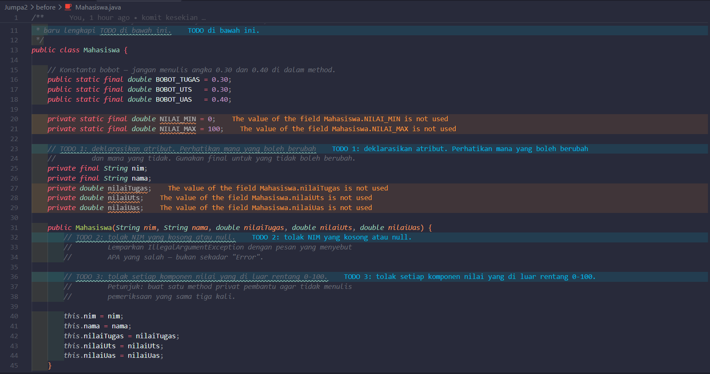
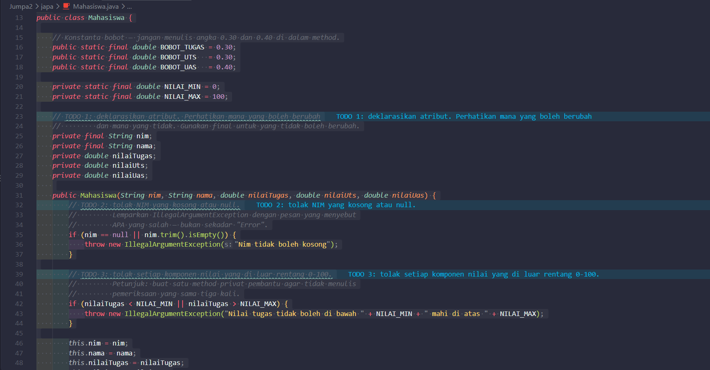
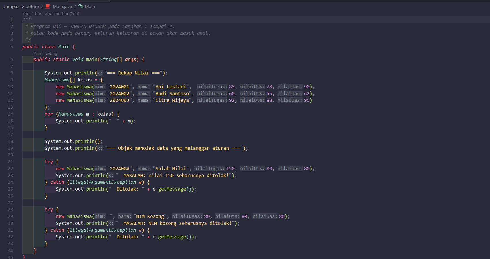
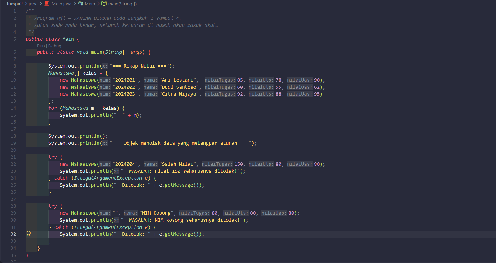
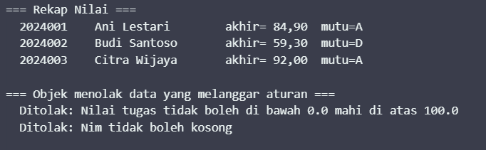
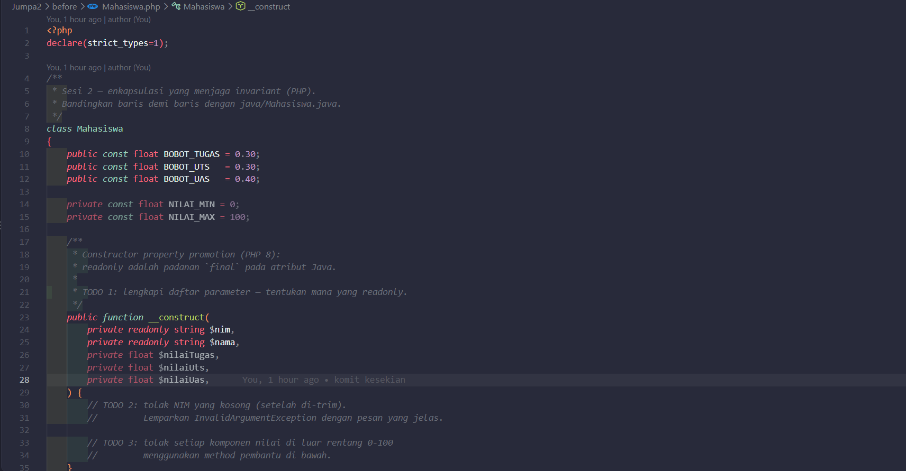
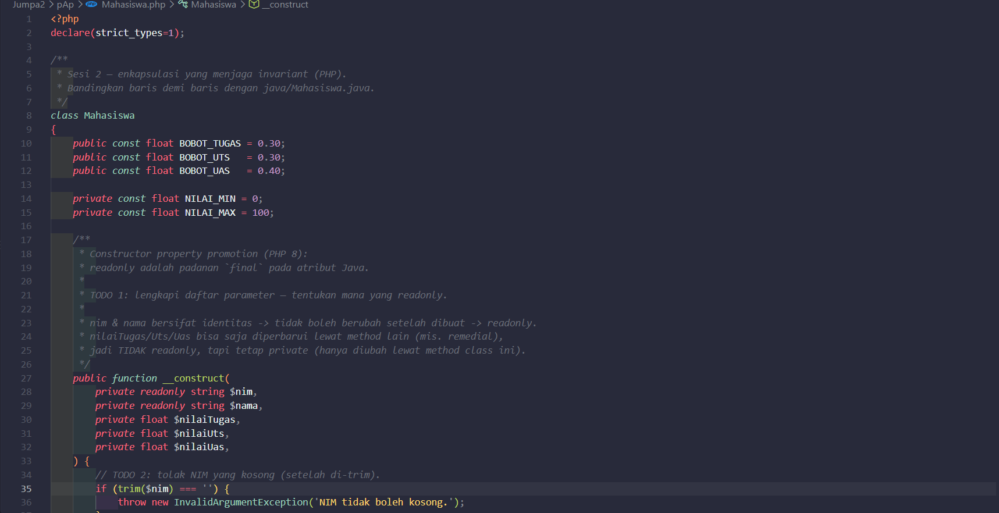
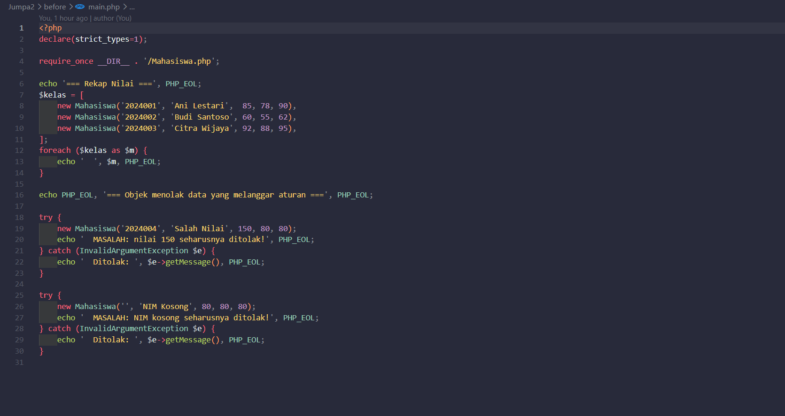
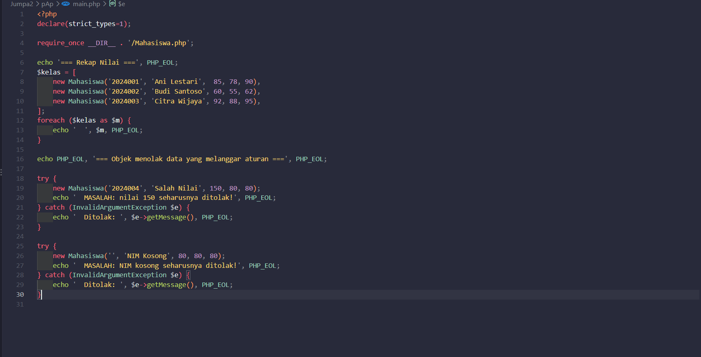
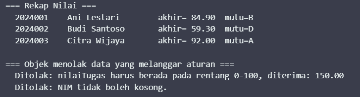

# LAPORAN PRAKTIKUM PEMROGRAMAN BERBASIS OBJEK

| Informasi Praktikan | Keterangan |
| :--- | :--- |
| **Nama** | Saka Laksmana Harimurti |
| **NPM** | 4525210067 |
| **Kelas** | A |
| **Mata Kuliah** | Pemrograman Berbasis Objek (PBO) |
| **Pertemuan** | [02] - [Kelas, Objek, dan Enkapsulasi] |
| **Tanggal** | [Kamis 10 September 2026] |

---

## 1. Implementasi Java

### 1.1. File: `Mahasiswa.java`
**Penjelasan Kode:**
> Kelas `Mahasiswa` menerapkan prinsip enkapsulasi dan penegakan *class invariant*. Variabel `nim` dan `nama` dideklarasikan sebagai `final` agar bersifat *immutable* setelah inisialisasi. Melalui konstruktor, dilakukan validasi bahwa `nim` tidak boleh kosong atau `null`, serta nilai komponen (tugas, UTS, UAS) harus berada pada rentang batas 0 sampai 100 dengan bantuan konstanta `BOBOT_TUGAS`, `BOBOT_UTS`, dan `BOBOT_UAS`. Method `nilaiAkhir()` menghitung akumulasi tertimbang dan `hurufMutu()` menentukan predikat huruf (A, B, C, D, E).

**Bukti Eksekusi (Screenshot):**
* **Before** *(Kondisi awal / Kesalahan kompilasi)*:
![SS Before Mahasiswa.java] 

* **After** *(Kondisi akhir / Eksekusi berhasil)*:
![SS After Mahasiswa.java] 

### 1.2. File: `Main.java`
**Penjelasan Kode:**
> Berkas utama (`Main.java`) bertugas menginstansiasi objek `Mahasiswa`, menguji mekanisme penanganan kesalahan (*exception handling*) saat input nilai/NIM tidak valid melalui blok `try-catch`, serta menampilkan daftar mahasiswa beserta nilai akhir dan huruf mutunya ke konsol.

**Bukti Eksekusi (Screenshot):**
* **Before** *(Kondisi awal / Kesalahan kompilasi)*:
![SS Before Main.java] 

* **After** *(Kondisi akhir / Eksekusi berhasil)*:
![SS After Main.java] 

### Output
**Output Program:**
![Output Java] 

---

## 2. Implementasi PHP

### 2.1. File: `Mahasiswa.php`
**Penjelasan Kode:**
> Menggunakan fitur *Constructor Property Promotion* dan tipe `readonly` pada PHP 8 untuk atribut `$nim` dan `$nama`. Validasi batas nilai diimplementasikan melalui fungsi statis internal `pastikanNilaiSah()` yang melempar `InvalidArgumentException` jika nilai tidak berada di rentang 0–100. Penentuan huruf mutu memanfaatkan ekspresi modern `match (true)`.

**Bukti Eksekusi (Screenshot):**
* **Before** *(Kondisi awal / Galat logika)*:
![SS Before Mahasiswa.php] 

* **After** *(Kondisi akhir / Eksekusi berhasil)*:
![SS After Mahasiswa.php] 

### 2.2. File: `main.php`
**Penjelasan Kode:**
> Berperan sebagai script eksekutor untuk menguji instansiasi objek `Mahasiswa`, validasi data, serta pemanggilan representasi string objek via method `__toString()`.

**Bukti Eksekusi (Screenshot):**
* **Before** *(Kondisi awal / Galat logika)*:
![SS Before main.php] 

* **After** *(Kondisi akhir / Eksekusi berhasil)*:
![SS After main.php] 

### Output
**Output Program:**
![Output PHP] 

---

## 3. Kesimpulan
> Enkapsulasi berfungsi untuk melindungi integritas status objek (*invariant*) dengan membatasi akses langsung ke atribut internal menggunakan *access modifier* `private`. Data hanya dapat dimodifikasi atau dibaca melalui konstruktor dan method *getter* yang sah dengan validasi ketat, baik di Java maupun PHP.