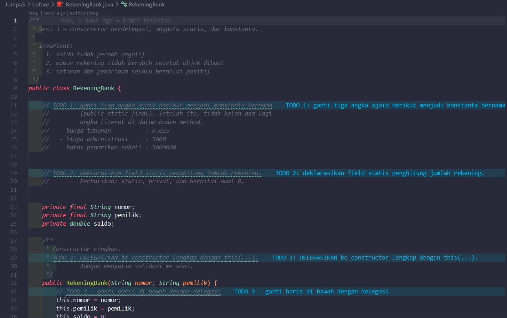
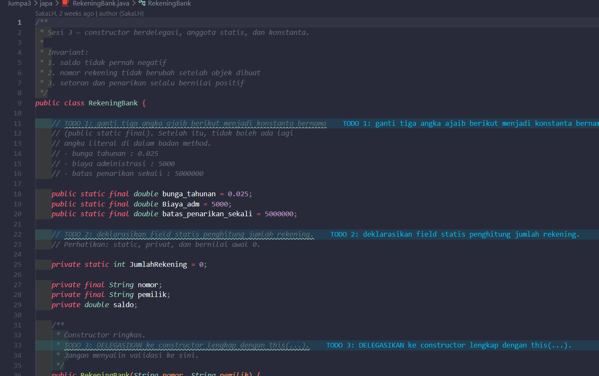
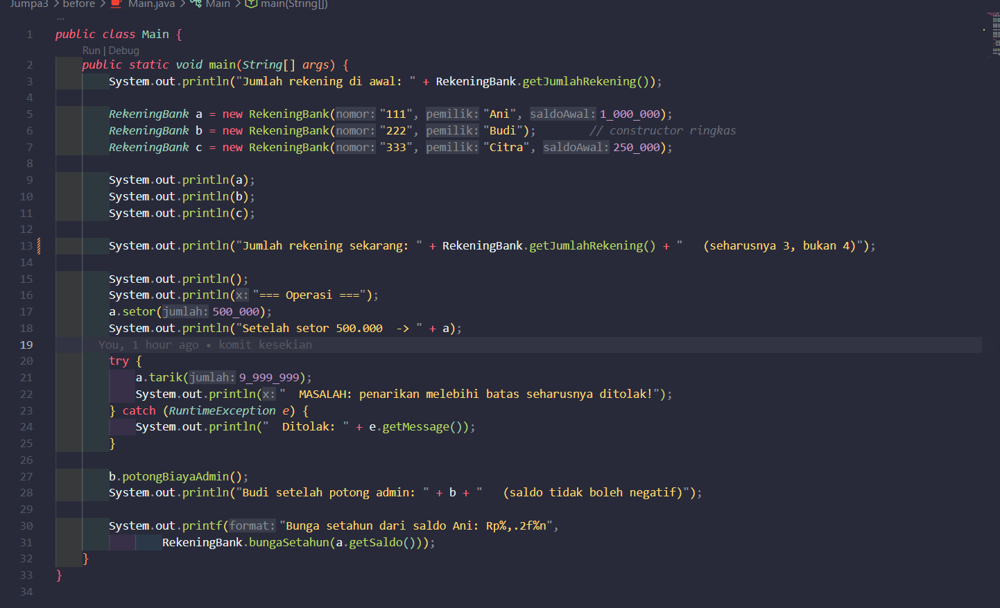
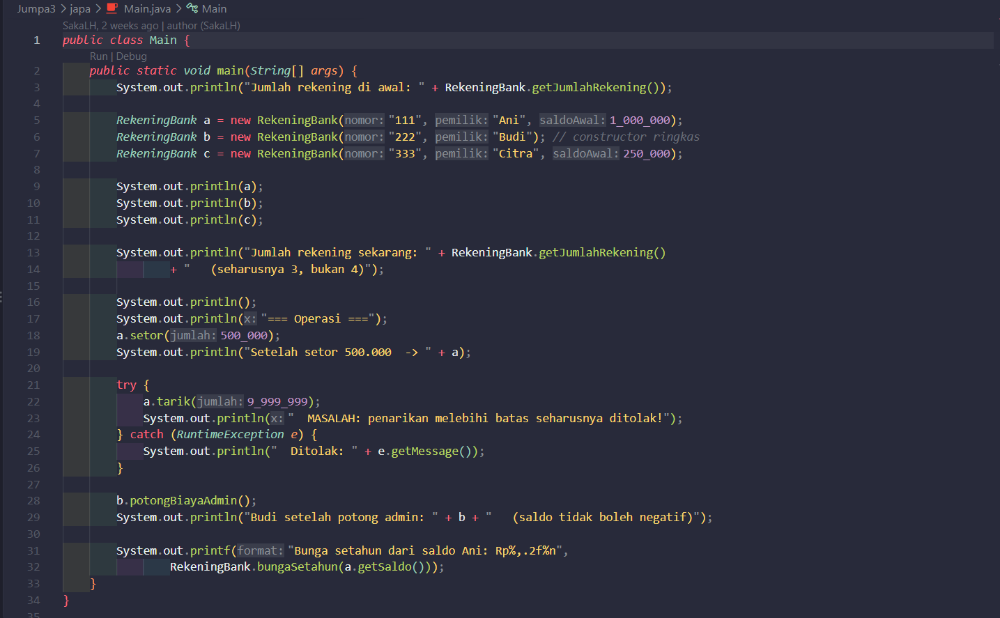
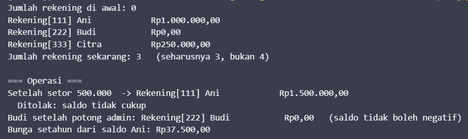
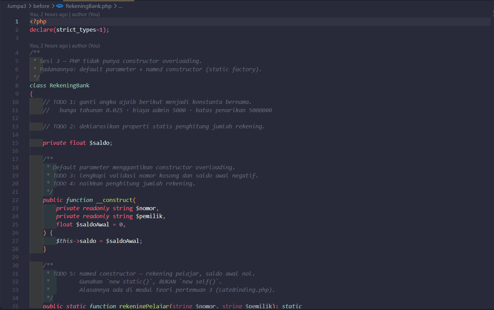
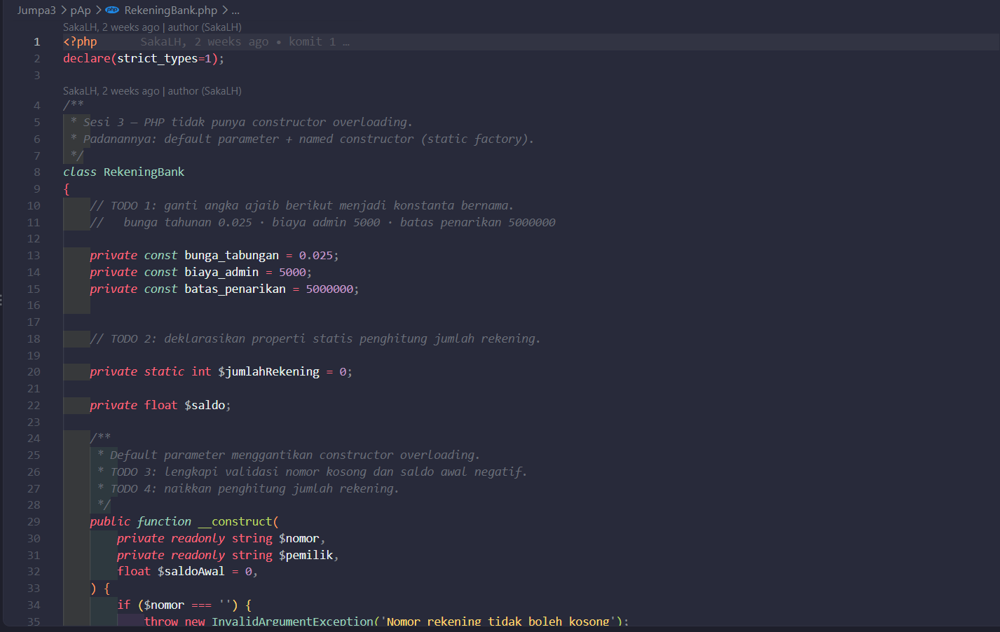
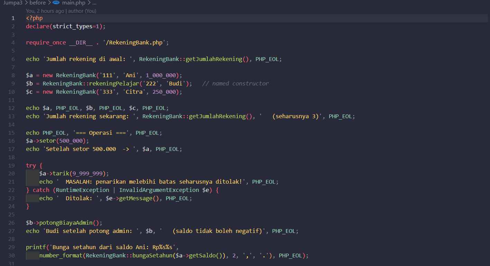
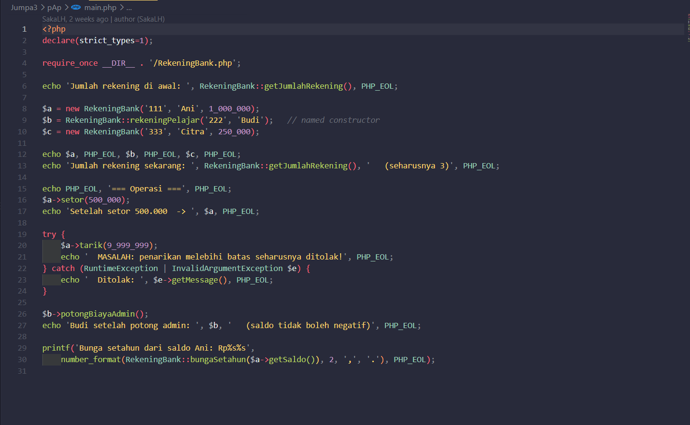
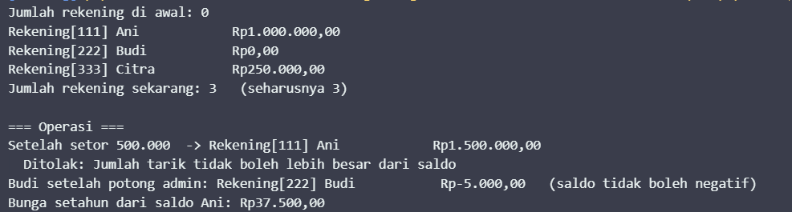

# LAPORAN PRAKTIKUM PEMROGRAMAN BERBASIS OBJEK

| Informasi Praktikan | Keterangan |
| :--- | :--- |
| **Nama** | Saka Laksmana Harimurti |
| **NPM** | 4525210067 |
| **Kelas** | A |
| **Mata Kuliah** | Pemrograman Berbasis Objek (PBO) |
| **Pertemuan** | [03] - [ Construktor, Anggota Statis, dan Konstanta ] |
| **Tanggal** | [Kamis 17 September 2026] |

---

## 1. Implementasi Java

### 1.1. File: `RekeningBank.java`
**Penjelasan Kode:**
> Kelas `RekeningBank` mendemonstrasikan penggunaan variabel *static* `totalRekening` untuk menghitung total rekening yang berhasil dibuat secara global lintas objek. Kelas ini memiliki konstanta `SALDO_MINIMAL` bernilai tetap. Konstruktor bertanggung jawab melakukan verifikasi saldo awal dan otomatisasi penomoran rekening. Method mutator seperti `setor()` dan `tarik()` memastikan invariant saldo tidak berada di bawah batas minimal.

**Bukti Eksekusi (Screenshot):**
* **Before** *(Kondisi awal / Kesalahan kompilasi)*:
![SS Before RekeningBank.java]

* **After** *(Kondisi akhir / Eksekusi berhasil)*:
![SS After RekeningBank.java]

### 1.2. File: `Main.java`
**Penjelasan Kode:**
> Menguji pembuatan beberapa instansi rekening bank, melakukan transaksi setor dan tarik dana, serta menampilkan total rekening aktif melalui method static tanpa perlu menginstansiasi objek baru.

**Bukti Eksekusi (Screenshot):**
* **Before** *(Kondisi awal / Kesalahan kompilasi)*:
![SS Before Main.java]

* **After** *(Kondisi akhir / Eksekusi berhasil)*:
![SS After Main.java]

### Output
**Output Program:**
![Output Java]

---

## 2. Implementasi PHP

### 2.1. File: `RekeningBank.php`
**Penjelasan Kode:**
> Implementasi padanan di PHP dengan keyword `self::$totalRekening` untuk anggota statis dan `self::SALDO_MINIMAL` untuk pemanggilan konstanta kelas. Menyediakan validasi transaksi penarikan saldo dan penambahan saldo dengan verifikasi nilai positif.

**Bukti Eksekusi (Screenshot):**
* **Before** *(Kondisi awal / Galat logika)*:
![SS Before RekeningBank.php]

* **After** *(Kondisi akhir / Eksekusi berhasil)*:
![SS After RekeningBank.php]

### 2.2. File: `main.php`
**Penjelasan Kode:**
> Melakukan instansiasi beberapa objek `RekeningBank`, simulasi mutasi saldo, serta memanggil `RekeningBank::getTotalRekening()` secara statis untuk membuktikan *state sharing* pada level kelas.

**Bukti Eksekusi (Screenshot):**
* **Before** *(Kondisi awal / Galat logika)*:
![SS Before main.php]

* **After** *(Kondisi akhir / Eksekusi berhasil)*:
![SS After main.php]

### Output
**Output Program:**
![Output PHP]

---

## 3. Kesimpulan
> Anggota statis (*static members*) terikat langsung pada kelas dan bukan pada instansi individu objek, sehingga nilainya dapat dibagikan secara global ke seluruh objek dari kelas tersebut. Penggunaan konstanta (`final` pada Java / `const` pada PHP) mencegah modifikasi nilai kritis yang harus konsisten sepanjang program berjalan.