# LAPORAN PRAKTIKUM PEMROGRAMAN BERBASIS OBJEK

| Informasi Praktikan | Keterangan |
| :--- | :--- |
| **Nama** | Saka Laksmana Harimurti |
| **NPM** | 4525210067 |
| **Kelas** | A |
| **Mata Kuliah** | Pemrograman Berbasis Objek (PBO) |
| **Pertemuan** | [04] - [Inheritance] |
| **Tanggal** | [Kamis 24 September 2026] |

---

## 1. Implementasi Java

### 1.1. File: `Pegawai.java`
**Penjelasan Kode:**
> Merupakan *super-class* (kelas induk) yang menyimpan atribut umum seperti `id`, `nama`, dan `gajiPokok`. Menyediakan fondasi metode `hitungTotalGaji()` yang nantinya dapat diwariskan serta di-override oleh kelas-kelas turunan (*sub-class*).

**Bukti Eksekusi (Screenshot):**
* **Before** *(Kondisi awal / Kesalahan kompilasi)*:
![SS Before Pegawai.java]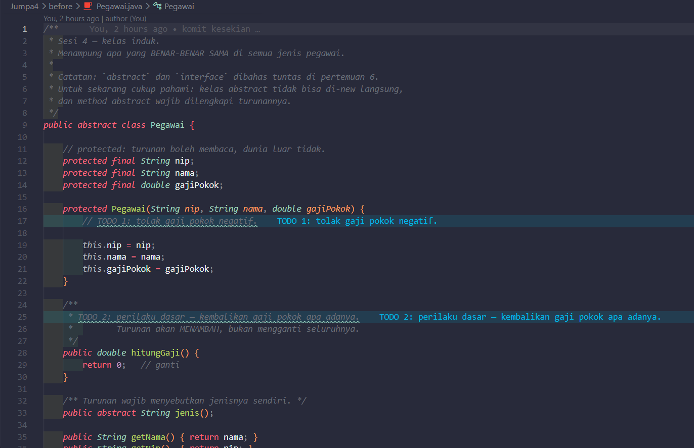

* **After** *(Kondisi akhir / Eksekusi berhasil)*:
![SS After Pegawai.java]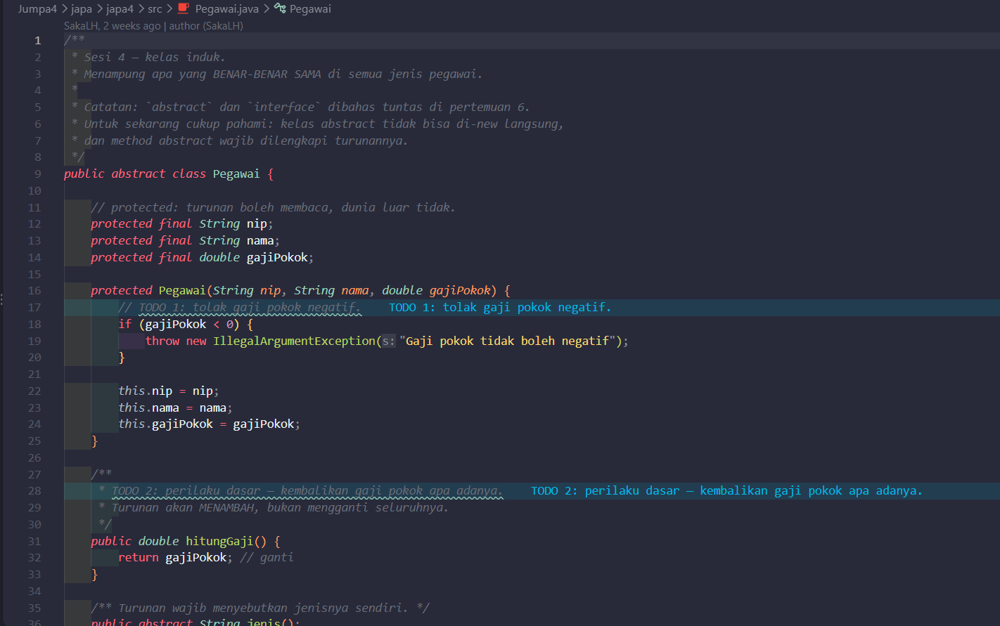

### 1.2. File: `PegawaiTetap.java` & `PegawaiKontrak.java`
**Penjelasan Kode:**
> Kelas turunan yang mewarisi `Pegawai` menggunakan kata kunci `extends`. `PegawaiTetap` menambahkan komponen tunjangan jabatan dan meng-override `hitungTotalGaji()`. Sedangkan `PegawaiKontrak` menambahkan atribut durasi kontrak atau tarif lembur dengan perhitungan gaji yang disesuaikan. Pemanggilan konstruktor induk dilakukan via `super()`.

**Bukti Eksekusi (Screenshot):**
* **Before** *(Kondisi awal / Kesalahan kompilasi)*:
![SS Before Subclass Pegawai]

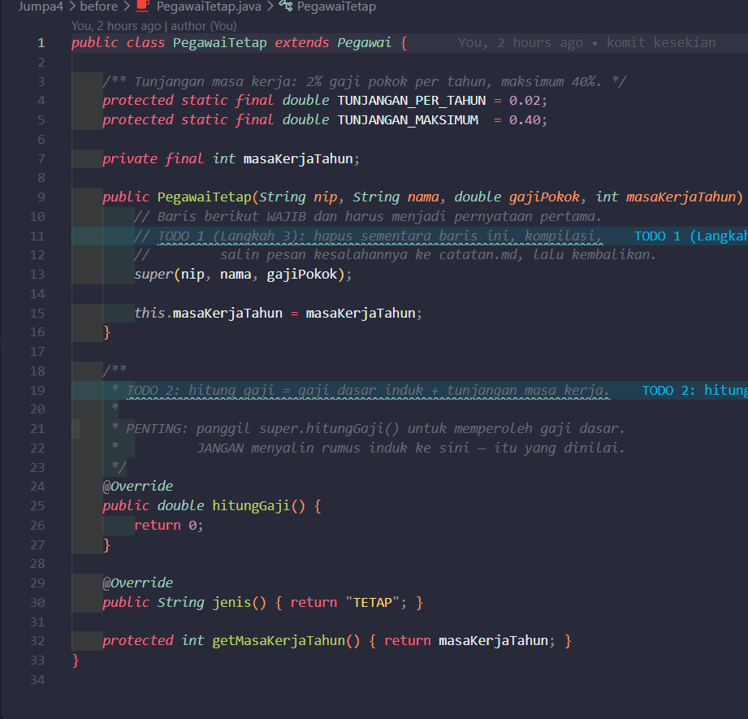

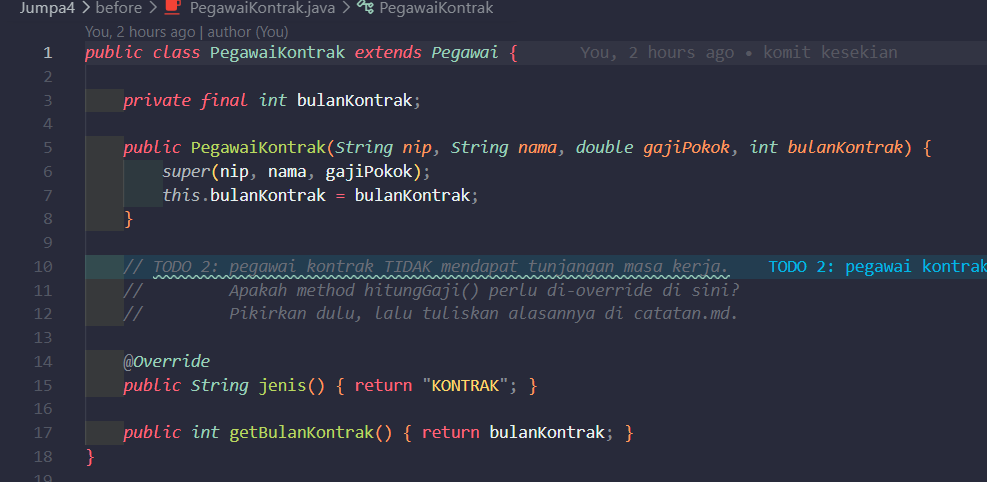

* **After** *(Kondisi akhir / Eksekusi berhasil)*:
![SS After Subclass Pegawai]

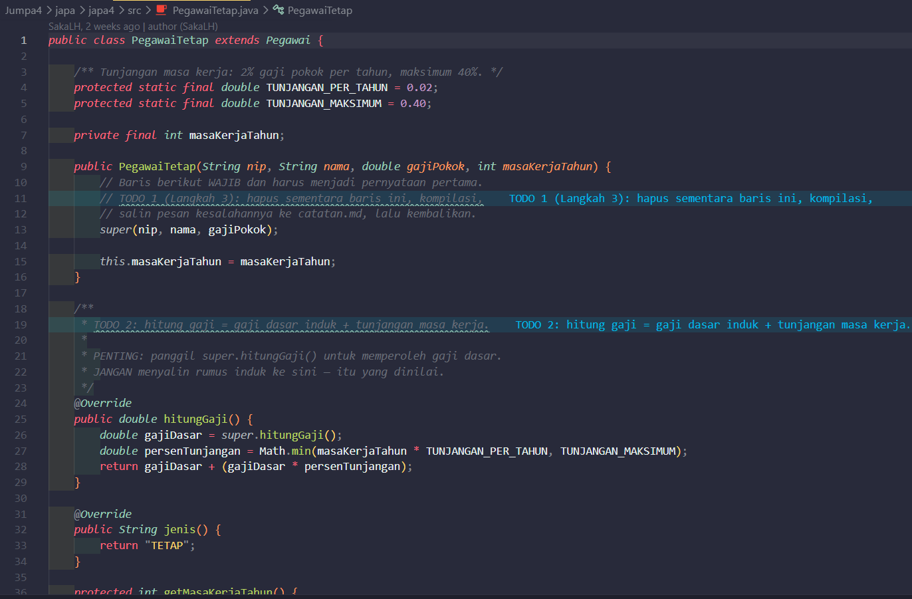

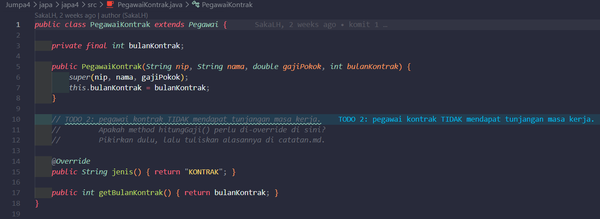

### 1.3. File: `Main.java`
**Penjelasan Kode:**
> Menginstansiasi objek `PegawaiTetap` dan `PegawaiKontrak`, menguji pewarisan properti dan metode dari kelas induk, serta mencetak rincian slip gaji masing-masing pegawai.

**Bukti Eksekusi (Screenshot):**
* **Before** *(Kondisi awal / Kesalahan kompilasi)*:
![SS Before Main.java]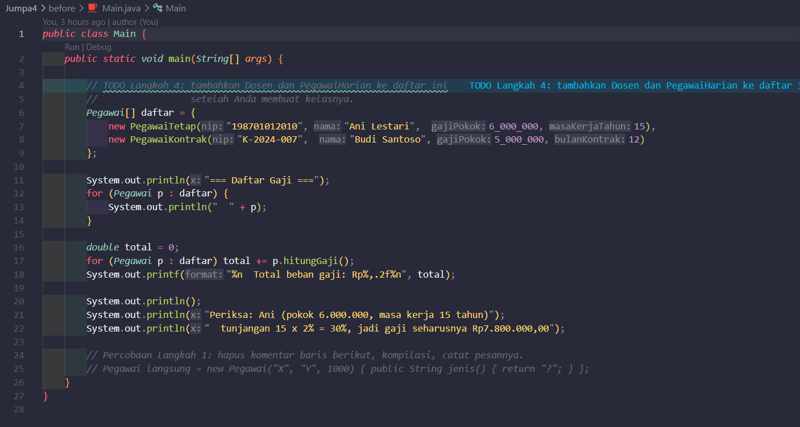

* **After** *(Kondisi akhir / Eksekusi berhasil)*:
![SS After Main.java]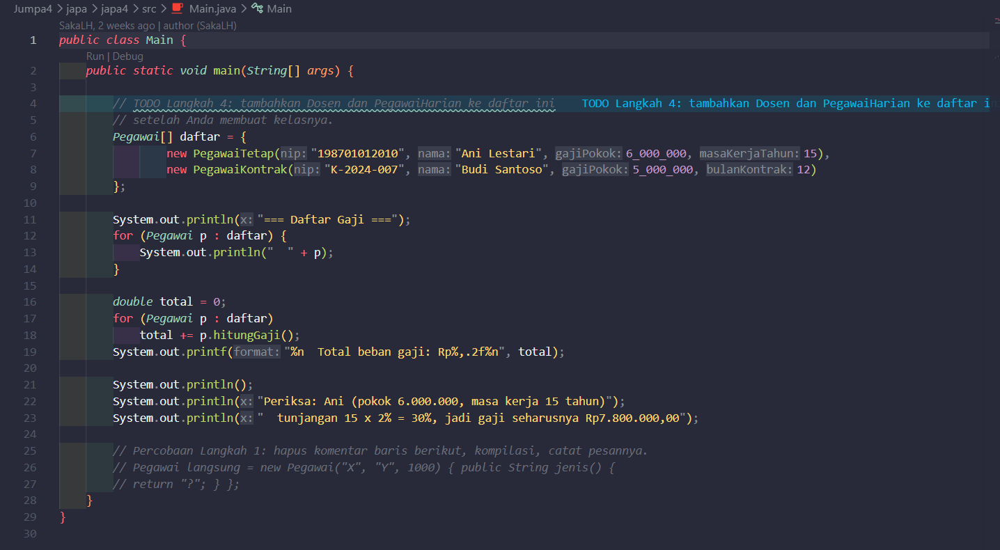

### Output
**Output Program:**
![Output Java]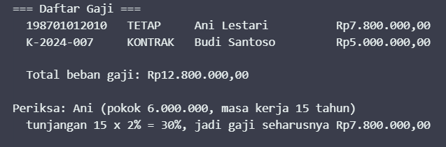

---

## 2. Implementasi PHP

### 2.1. File: `Pegawai.php`
**Penjelasan Kode:**
> Menampung definisi kelas induk `Pegawai` beserta subkelas `PegawaiTetap` dan `PegawaiKontrak` yang meng-override kalkulasi gaji menggunakan sintaks `parent::__construct()` untuk meneruskan nilai ke kelas induk.

**Bukti Eksekusi (Screenshot):**
* **Before** *(Kondisi awal / Galat logika)*:
![SS Before Pegawai.php]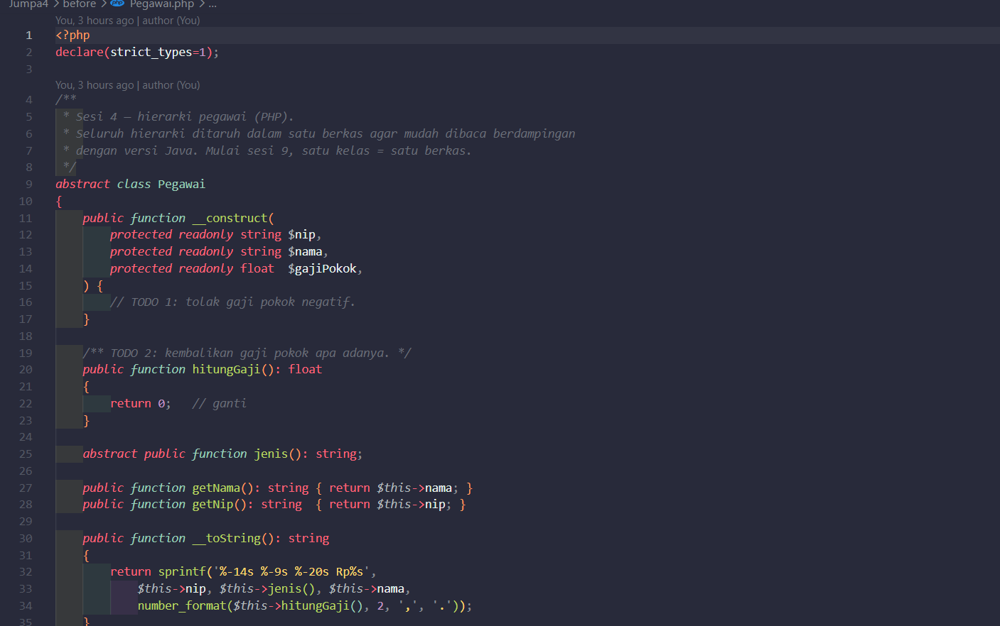

* **After** *(Kondisi akhir / Eksekusi berhasil)*:
![SS After Pegawai.php]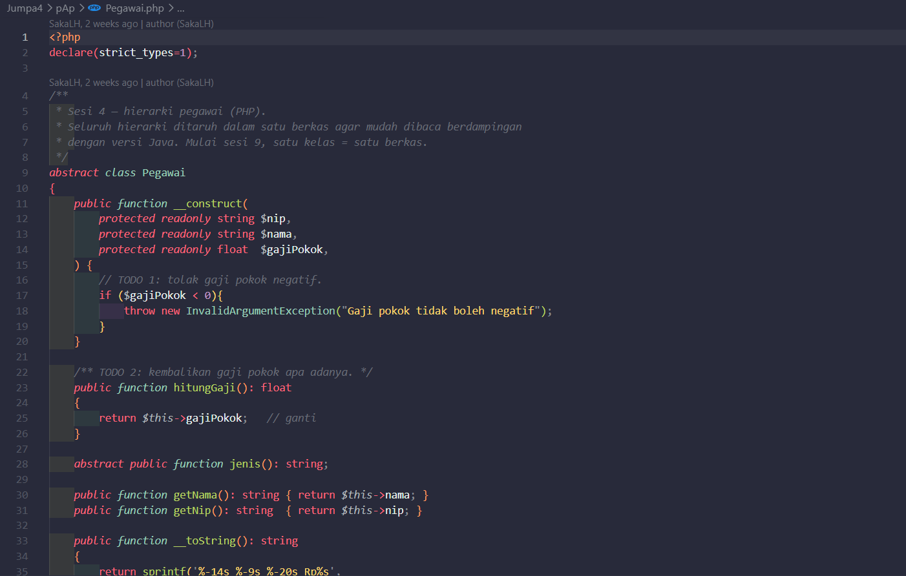

### 2.2. File: `main.php`
**Penjelasan Kode:**
> Memanggil dan membuat instansi `PegawaiTetap` dan `PegawaiKontrak` di PHP, serta menampilkan rincian total gaji yang dihasilkan dari method overriding ke output terminal.

**Bukti Eksekusi (Screenshot):**
* **Before** *(Kondisi awal / Galat logika)*:
![SS Before main.php]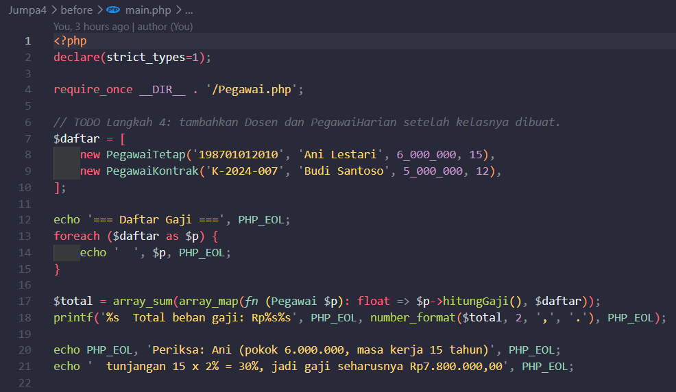

* **After** *(Kondisi akhir / Eksekusi berhasil)*:
![SS After main.php]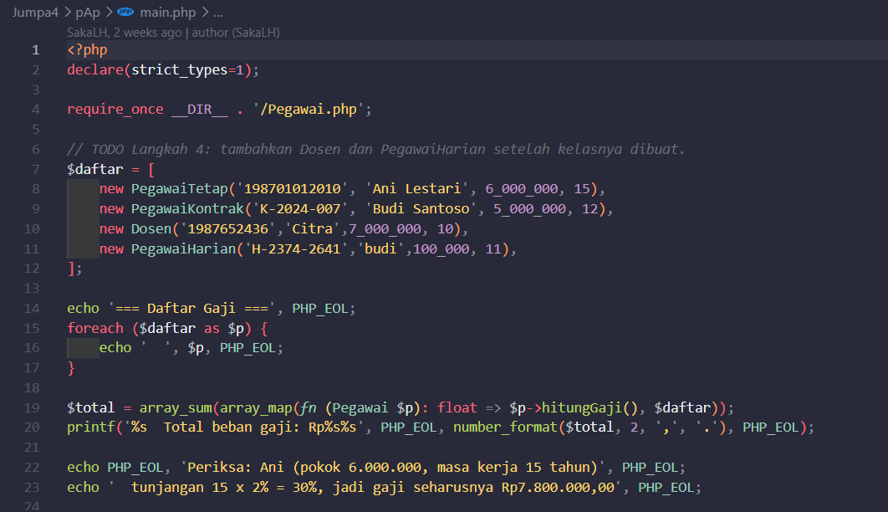

### Output
**Output Program:**
![Output PHP]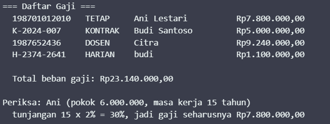

---

## 3. Kesimpulan
> Pewarisan (*Inheritance*) memungkinkan pembagian struktur kode yang dapat digunakan kembali (*reusability*) dari kelas induk ke kelas anak. Melalui mekanisme *method overriding* dan kata kunci `super` / `parent`, sub-class dapat menyesuaikan perilaku method spesifik tanpa menduplikasi definisi atribut dasar.